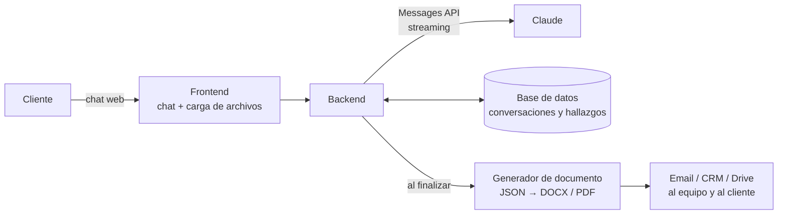

# Asistente virtual de Discovery y Relevamiento

Un asistente conversacional que entrevista al cliente solicitante de un desarrollo, cubre todo el relevamiento y genera un **Documento de Discovery y Relevamiento** profesional, basado en lo investigado en este repositorio.

| Archivo | Contenido |
|---------|-----------|
| [`system-prompt.md`](system-prompt.md) | El prompt del asistente: rol, técnica de entrevista, 13 etapas de cobertura, módulos por tipo de proyecto, comandos y la estructura completa del documento final. |
| Este README | Cómo ponerlo en marcha, desde una prueba sin código hasta una aplicación propia. |

---

## Cómo está diseñado el prompt

El prompt traduce el contenido del repositorio a instrucciones de conducta:

| Del repositorio | En el asistente |
|-----------------|-----------------|
| [Técnicas de relevamiento](../docs/02-tecnicas-de-relevamiento.md): entrevistas, 5 porqués, *The Mom Test* | Principios de la entrevista: una pregunta por vez, preguntas abiertas, hechos concretos, separar necesidad de solución, no inducir |
| [Guion de entrevista](../plantillas/02-guion-de-entrevista.md) y [cuestionario inicial](../plantillas/01-cuestionario-primer-contacto.md) | Las 13 etapas, cada una con su lista de cobertura |
| [Checklist de no funcionales](../plantillas/11-checklist-requisitos-no-funcionales.md) (ISO 25010) | Etapa 10, con preguntas en lenguaje cotidiano |
| [Proceso de discovery](../docs/06-proceso-de-discovery.md): variantes por tipo de proyecto | Módulos por tipo de proyecto |
| [Visión y Alcance](../plantillas/05-vision-y-alcance.md), [historias de usuario](../plantillas/09-historia-de-usuario.md), [trazabilidad](../plantillas/12-matriz-de-trazabilidad.md), BRD/SRS | La estructura de 20 secciones del documento final |
| [Errores comunes](../docs/07-errores-comunes.md) | Reglas: fuera de alcance explícito, supuestos marcados, requisitos medibles, glosario, validar lo entendido |

Tres decisiones de diseño importantes:

1. **Fidelidad antes que completitud aparente.** Lo que no se habló se marca como `[Pendiente]` o `[Supuesto — a validar]`, nunca se inventa. Un documento con huecos visibles es mucho más útil que uno "completo" con datos plausibles pero falsos.
2. **Cobertura verificable.** Cada etapa tiene una lista concreta, y el cliente puede ver el avance con `/estado`.
3. **Conversaciones largas.** `/pausa` genera un resumen para retomar en otra sesión, porque un relevamiento real no siempre se hace de una sola vez.

---

## Opción 1 — Prototipo sin código (recomendada para empezar)

Ideal para probar y ajustar el prompt en una tarde, o para usarlo vos mismo como copiloto en reuniones con clientes.

**Con un Proyecto de Claude (claude.ai):**
1. Creá un Proyecto nuevo, por ejemplo "Asistente de Discovery".
2. En **Instrucciones del proyecto**, pegá el contenido de [`system-prompt.md`](system-prompt.md) desde la línea `# Rol` hasta el final.
3. Opcional: subí como conocimiento del proyecto algunos archivos del repo, como [`docs/03-documentos-y-artefactos.md`](../docs/03-documentos-y-artefactos.md) y las plantillas, para que pueda consultar las definiciones.
4. Abrí una conversación y hacé de cliente.

**Con otras plataformas:** el prompt no depende de ninguna función particular, así que también funciona como GPT personalizado (ChatGPT), Gem (Gemini) o agente de Copilot Studio, con ajustes mínimos.

**Limitación:** para que un cliente externo lo use, necesitaría acceso a tu cuenta o espacio. Para darle a los clientes un link propio, pasá a la opción 2.

---

## Opción 2 — Aplicación propia con la API de Claude

Para ofrecer el asistente a clientes desde tu web, con tu marca, y recibir el documento automáticamente.

### Arquitectura sugerida

### Recomendaciones técnicas

| Tema | Recomendación |
|------|---------------|
| **Modelo** | `claude-opus-5-5` (Claude Opus 5.5): buen razonamiento para detectar vacíos y contradicciones y redactar el documento. Es el más conveniente para empezar; después se puede medir si un modelo más económico mantiene la calidad. |
| **Razonamiento** | Thinking adaptativo (viene activo por defecto). Esfuerzo (`output_config.effort`) en `medium` durante la entrevista, para respuestas ágiles, y `high` en la llamada que genera el documento. |
| **Prompt caching** | El system prompt es largo y no cambia: ponelo primero, sin fechas ni datos variables, y marcalo con `cache_control`. Cada turno de la conversación lo reutiliza a una fracción del costo. Verificalo con `usage.cache_read_input_tokens`. |
| **Streaming** | Siempre: la respuesta aparece mientras se genera y se evitan timeouts en el documento final, que es largo. |
| **Estado** | Guardá la conversación completa en tu base de datos. Así se puede pausar y retomar sin depender de `/pausa`. |
| **Archivos del cliente** | PDF e imágenes se envían como bloques `document` / `image`, por ejemplo formularios, planillas exportadas o capturas del sistema actual. |
| **Documento final** | En lugar de pedir Markdown libre, pedí la salida en **JSON con un esquema fijo** (*structured outputs*) que refleje las 20 secciones, y armá el DOCX o PDF con tu plantilla corporativa (por ejemplo, con `python-docx` o `docxtpl`). El formato queda siempre igual y el contenido se puede cargar en Jira, Notion o un CRM. |
| **Notas estructuradas (opcional)** | Una herramienta `registrar_hallazgo(etapa, tipo, contenido)` que el modelo llama durante la entrevista. Hace que `/estado` sea exacto y que el documento se arme desde datos guardados, no solo desde la memoria de la conversación. |
| **Privacidad** | Informá al cliente que la conversación se procesa con IA y cómo se guardan sus datos (aviso y consentimiento). No pidas credenciales. Definí cuánto tiempo conservás las conversaciones. |
| **Revisión humana** | El documento debería pasar por un analista de tu equipo antes de usarse para cotizar. El asistente hace el relevamiento pesado; la persona valida. |

### Alternativa: Claude Managed Agents

Si preferís no programar ni hospedar el ciclo del agente, **Managed Agents** (beta) de Anthropic aloja el agente y un entorno donde puede, por ejemplo, generar el DOCX directamente. Tu backend solo crea sesiones y retransmite mensajes. Se cobra el tiempo de sesión además de los tokens.

---

## Cómo probarlo antes de usarlo con clientes reales

1. **Clientes simulados.** Escribí entre 3 y 5 "fichas secretas" de clientes ficticios, por ejemplo: una pyme que quiere digitalizar pedidos, una startup con una app de turnos, un organismo que reemplaza un sistema viejo. Cada ficha tiene todos los datos del caso, incluidas reglas de negocio ocultas que solo se revelan si se pregunta bien. Otra instancia del modelo hace de cliente usando la ficha.
2. **Evaluá el resultado contra la ficha:**
   - ¿Qué porcentaje de la información de la ficha llegó al documento? (cobertura)
   - ¿El documento contiene algo que no estaba en la ficha ni en la conversación? (invenciones: deberían ser cero)
   - ¿Hizo una pregunta por vez? ¿Detectó la solución disfrazada de necesidad?
   - ¿El fuera de alcance, los supuestos y las preguntas abiertas son correctos?
3. **Ajustá el prompt** según los fallos y repetí. Guardá las fichas como set de pruebas para cada cambio futuro.

---

## Próximos pasos posibles

- [ ] Probar el prompt en un Proyecto de Claude con 2 o 3 casos simulados.
- [ ] Escribir las fichas de clientes simulados como set de evaluación (`asistente/evaluacion/`).
- [ ] Definir el esquema JSON del documento final.
- [ ] Crear la plantilla DOCX corporativa.
- [ ] Construir el MVP de la aplicación web (opción 2).
